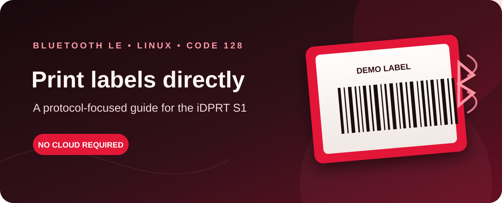

<p align="center">
  
</p>

# iDPRT S1 Bluetooth LE label printing

Print Code 128 labels directly from Linux to an iDPRT S1 over Bluetooth Low
Energy (BLE). This repository focuses on the printer connection, observed GATT
commands, raster format, and a small Python example. It does not include a web
app, Docker deployment, internet hosting, or any machine-specific configuration.

> **Compatibility:** the command sequence here was experimentally verified with
> an iDPRT S1. It is not an official protocol specification and is not a
> universal driver for other printer models or firmware versions.

## How it works

```text
Python label renderer
        │  384-dot monochrome raster
        ▼
Bleak ── Bluetooth LE GATT ── iDPRT S1
```

The printer is controlled by the Linux computer running this program. The
computer must be within BLE range of the printer; no cloud service or network
connection is involved.

## Requirements

- Linux with BlueZ and a working Bluetooth LE adapter
- Python 3.10 or newer
- An iDPRT S1 advertising over BLE
- The printer's advertised BLE name

The implementation is specific to the S1's observed BLE service and raster
protocol. Other iDPRT models may use different commands or image dimensions.

## Install and print

Install the operating-system Bluetooth tools and DejaVu font. On Debian or
Ubuntu:

```sh
sudo apt install bluez fonts-dejavu-core python3-venv
```

Create an isolated Python environment and install the project dependencies:

```sh
git clone https://github.com/YOUR-USERNAME/s1-label-printer.git
cd s1-label-printer
python3 -m venv .venv
.venv/bin/pip install -r requirements.txt
```

Turn on the printer and find its advertised name:

```sh
bluetoothctl scan on
```

Stop scanning with `bluetoothctl scan off`, then set the name shown for your
printer and print a test value:

```sh
export PRINTER_NAME='the-name-shown-by-bluetoothctl'
.venv/bin/python print_cli.py 'DEMO123'
```

The BLE name can contain a device-specific suffix. Use the name advertised by
your own printer; this project deliberately contains no device address or
machine-specific identifier.

The printer must be on and advertising when the command runs. The program
uppercases the value, generates the barcode and caption as a 384-dot raster,
and sends it directly over BLE. Some values may be rejected if their barcode
would exceed the printable width.

## Observed BLE protocol

These findings are from successful communication with an S1 and are included
for learning and troubleshooting. They may vary by firmware:

| Item | Observed value |
| --- | --- |
| BLE service | `0000ff00-0000-1000-8000-00805f9b34fb` |
| Write characteristic | `0000ff02-0000-1000-8000-00805f9b34fb` |
| Notification characteristic observed during probing | `0000ff03-0000-1000-8000-00805f9b34fb` |

The printer accepted the following sequence:

1. Enable printing: `10 FF F1 03`
2. Send twelve zero bytes.
3. Set density: `10 FF 10 00 01`
4. Send the raster command in BLE writes of up to 100 bytes, with a short pause
   between writes.
5. Feed 80 dots: `1B 4A 50`
6. Stop: `10 FF F1 45`

The image is encoded with the ESC/POS-style `GS v 0` raster header:

```text
1D 76 30 00  <width in bytes: little-endian>  <height in dots: little-endian>
```

The tested S1 output is 384 dots wide, or 48 bytes per row. The raster data
follows the header, one row at a time, with the most-significant bit of each
byte representing the leftmost pixel. The implementation uses a 203 dpi
Code 128 image, rejects barcodes that do not fit, and appends a small blank
tear-off tail before the printer feed command.

The write characteristic was sufficient for printing in these tests;
notifications are not required by the included print path. During protocol
probing, a notification characteristic was observed at `FF03`; a separate
probe of `FF01` did not receive the same replies.

## Troubleshooting

- **Printer not found:** confirm it is on, close its companion phone app, and
  verify the exact advertised name with `bluetoothctl scan on`.
- **BLE connection fails:** check `systemctl status bluetooth` and confirm the
  adapter is powered with `bluetoothctl show`.
- **BlueZ reports a profile error:** this printer uses BLE GATT, not classic
  Bluetooth RFCOMM. Do not select an RFCOMM channel or pair it as a serial
  printer.
- **Controller mode:** on some Linux adapters, BlueZ may need to be configured
  for LE operation. Changing `ControllerMode` can disable classic Bluetooth
  profiles for that adapter, so review the effect on other devices before
  changing the system-wide BlueZ configuration.
- **Barcode too wide:** use a shorter value. The renderer rejects a barcode
  that would be cropped by the 384-dot print width.

## Tests

The unit tests cover raster dimensions, uppercase normalization, oversized
barcodes, and validation before any Bluetooth scan:

```sh
.venv/bin/python -m unittest discover -s tests -v
```

## Privacy and scope

This project prints locally over BLE. It has no website, telemetry, saved
labels, account integration, device address, or host-specific URL. Set the
printer's advertised name in your local shell rather than committing it.
